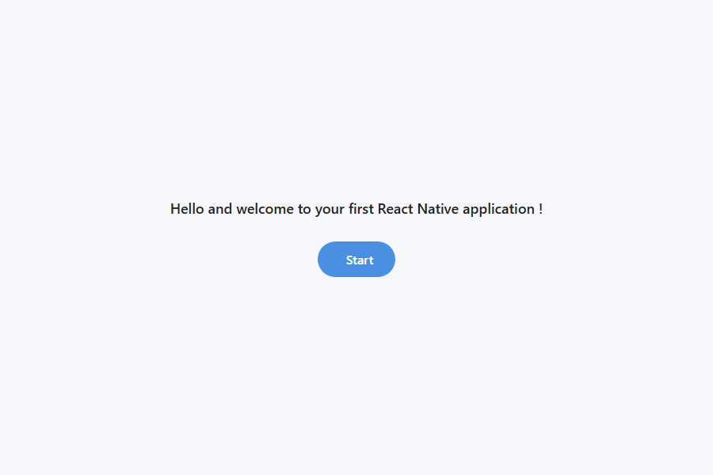

<div align="center">


<a href="https://github.com/Lagmouchyoussef/react-native-expo-setup">
  
</a>

<br/>


</div>

# 📱 React Native Expo Setup

A step-by-step guide to setting up a React Native development environment with Node.js, npm and Expo, followed by the creation and execution of a first mobile application.

> 🎓 **Context:** Lab 1 (TP1) of the *Mobile Development* course, 4IIR, EMSI.

---

## 📑 Table of Contents

1. [Overview](#-overview)
2. [Prerequisites](#-prerequisites)
3. [Step 1 - Install and verify Node.js](#-step-1---install-and-verify-nodejs)
4. [Step 2 - Understand the choice of Expo](#-step-2---understand-the-choice-of-expo)
5. [Step 3 - Prepare the tools](#-step-3---prepare-the-tools)
6. [Step 4 - Create the project](#-step-4---create-the-project)
7. [Step 5 - Explore the project structure](#-step-5---explore-the-project-structure)
8. [Step 6 - Write the first screen](#-step-6---write-the-first-screen)
9. [Step 7 - Run the application](#-step-7---run-the-application)
10. [Troubleshooting](#-troubleshooting)
11. [Project structure](#-project-structure)
12. [Resources](#-resources)

---

## 🎯 Overview

By the end of this lab you will be able to:

- Install Node.js and understand the role of `npm` and `yarn`.
- Configure a complete development environment.
- Create and run a working React Native project with Expo.
- Identify the structure of a project and the role of its key files.

## 🧰 Prerequisites

| Tool | Purpose |
|------|---------|
| [Node.js](https://nodejs.org/en/download) (LTS) | JavaScript runtime used by the build tools (Metro bundler) |
| npm (installed with Node.js) | Package manager |
| [Visual Studio Code](https://code.visualstudio.com/) | Code editor |
| [Expo Go](https://expo.dev/go) on a phone *(optional)* | Run the app on a physical device |
| [Android Studio](https://developer.android.com/studio) *(optional)* | Android emulator |

---

## 📦 Step 1 - Install and verify Node.js

Node.js is a server-side JavaScript runtime. React Native uses it to run the build tools, manage dependencies through a package manager and run the development server.

### 1.1 Install Node.js

1. Go to <https://nodejs.org/en/download>.
2. Download an **LTS** version for your operating system (`.msi` on Windows, `.pkg` on macOS).
3. Run the installer and keep the recommended options.
4. Restart your terminal if necessary.

> 💡 **Note:** If you install from the source code instead of the installer, you must add the `bin` folder to the `PATH` environment variable manually.

### 1.2 Verify the installation

Open the integrated terminal of VS Code (**Terminal → New Terminal**), or PowerShell / CMD, and run:

```bash
node --version
npm --version
npx --version
```

Each command must print a version number. Example from this project:

```text
v26.11.1
11.20.0
11.20.0
```

### 1.3 Run a first JavaScript program

Create a file named `main.js` in a working folder:

```js
console.log("Hello, World!");
```

Run it:

```bash
node main.js
```

The terminal must display:

```text
Hello, World!
```

---

## 🤔 Step 2 - Understand the choice of Expo

React Native lets you build mobile applications in JavaScript or TypeScript. There are two main approaches.

| | **Expo** | **React Native CLI / Community CLI** |
|---|---|---|
| Setup | Simple and fast | Requires native configuration |
| Create a project | `npx create-expo-app` | `npx @react-native-community/cli init` |
| Native code | Available through *Prebuild* if needed | Direct access to the Android / iOS projects |
| Testing on a phone | Expo Go or a development build | A compiled and installed app |
| Emulators | Optional at the beginning | Useful for local development |
| Best for | Beginners, prototypes, common projects | Projects that need direct control of native components |

✅ **This lab uses Expo.** It lets you focus on React Native components and the interface without starting with a full native configuration.

---

## 🔧 Step 3 - Prepare the tools

### 3.1 Expo account and Expo Go

- Visit <https://expo.dev/>. An account is **not required** for local use.
- On an Android or iOS smartphone, install the **Expo Go** app from the official store.
- Do **not** run `npm install -g expo-cli`. Modern commands use `npx expo`.

### 3.2 npm, Yarn and npx

- **npm** is the package manager installed with Node.js. It downloads libraries and manages their versions.
- **Yarn** is an alternative that uses `yarn install` and the `yarn.lock` file to keep installed versions consistent. Installing it is optional.
- **npx** ships with npm and runs a project tool without installing it globally.

This lab uses **npm**.

### 3.3 PowerShell configuration (Windows only)

If scripts are blocked, open PowerShell **as administrator** and run:

```powershell
Set-ExecutionPolicy RemoteSigned
```

Type `Y` to confirm. This allows npm scripts to run.

---

## 🆕 Step 4 - Create the project

`create-react-native-app` is obsolete. The recommended command today is `npx create-expo-app`.

In the VS Code terminal, go to the folder where your projects are stored and run:

```bash
npx create-expo-app@latest MOBILE_DEMO1 --template blank
```

This creates a `MOBILE_DEMO1` folder with the basic structure and installs the dependencies.

Open the project in VS Code:

```bash
cd MOBILE_DEMO1
code .
```

If the `code` command is not recognized, use **File → Open Folder** in VS Code.

---

## 📂 Step 5 - Explore the project structure

The exact structure depends on the chosen Expo template. With the minimal `blank` template you will find:

| File / folder | Role |
|---------------|------|
| `App.js` | Main component of the application: contains the interface and its initial logic |
| `app.json` | Expo configuration: name, identifier, icon and application settings |
| `package.json` | Project metadata, dependencies and available scripts |
| `package-lock.json` | Locks the versions of the dependencies installed with npm |
| `node_modules/` | Installed libraries. Generated automatically |
| `assets/` | Icons and images |
| `index.js` | Entry point that registers the root component |

> The `index.js` file is not necessarily present in every recent Expo template, so do not assume that all projects have exactly the same structure.

---

## 💻 Step 6 - Write the first screen

Open `App.js` and replace its content with the following code:

```jsx
import { StatusBar } from 'expo-status-bar';
import { StyleSheet, Text, View, TouchableOpacity, Image, Alert } from 'react-native';

export default function App() {
  return (
    <View style={styles.container}>

      <Text style={styles.title}>Hello and welcome to your first React Native application !</Text>

      <TouchableOpacity
        style={styles.button}
        onPress={() => Alert.alert('Well done !', 'Button clicked ')}
      >
        <Text style={styles.buttonText}>Start</Text>
      </TouchableOpacity>
      <StatusBar style="auto" />
    </View>
  );
}

const styles = StyleSheet.create({
  container: {
    flex: 1, backgroundColor: '#F5F7FA', alignItems: 'center', justifyContent: 'center', padding: 20,
  },
  title: {
    fontSize: 18, fontWeight: '600', textAlign: 'center', color: '#222', marginBottom: 30,
  },
  button: {
    flexDirection: 'row', alignItems: 'center', backgroundColor: '#4A90E2',
    paddingVertical: 12, paddingHorizontal: 28, borderRadius: 25,
  },
  buttonText: {
    color: '#fff', fontSize: 16, fontWeight: '600', marginLeft: 8,
  },
});
```

What the code does:

- `View` is the container, `Text` displays text and `TouchableOpacity` is a pressable button.
- `Alert.alert(...)` opens a native alert when the button is pressed.
- `StyleSheet.create` groups the styles in one object. Flexbox (`alignItems`, `justifyContent`) centers the content.

---

## 🚀 Step 7 - Run the application

From the project folder, start the development server:

```bash
npx expo start
```

The server starts and displays a QR code together with launch options.

### 📱 Option A - Physical phone

1. Install **Expo Go**.
2. Scan the QR code displayed in the terminal.
3. Make sure the phone and the computer are on the same network.
4. If the connection fails, try:

```bash
npx expo start --tunnel
```

### 🤖 Option B - Android emulator

1. Install **Android Studio**.
2. Install the Android SDK components and the Android Emulator.
3. Create and start a virtual device from the **Device Manager**.
4. Start Expo and press `a` in the terminal.

> The first setup requires downloading the Android tools.

### 🌐 Option C - Web browser

Expo can also render the app in a browser. This needs three extra packages:

```bash
npx expo install react-dom react-native-web @expo/metro-runtime
npx expo start --web
```

Then open <http://localhost:8081>.

### ✅ Result

The home screen of the application, rendered in the browser:



> ⚠️ **Note:** `Alert.alert` is a native feature and shows nothing in the web version. Use Expo Go or an Android emulator to see the alert when pressing **Start**.

---

## 🐞 Troubleshooting

| Problem | Solution |
|---------|----------|
| `node` or `npm` is not recognized | Restart the terminal, or check that the Node.js `bin` folder is in `PATH` |
| `code .` is not recognized | Use **File → Open Folder** in VS Code |
| npm scripts are blocked on Windows | Run `Set-ExecutionPolicy RemoteSigned` in an administrator PowerShell |
| The phone cannot reach the dev server | Check that both devices are on the same network, or use `npx expo start --tunnel` |
| Port 8081 already in use | Stop the other process, or accept the alternative port proposed by Expo |
| Changes do not appear in the browser | Refresh the page (reload is disabled when `CI=1` is set) |

---

## 🌳 Project structure

```text
MOBILE_DEMO1/
├── assets/              # Icons and images
├── docs/
│   └── screenshots/     # Screenshots used in this README
├── App.js               # Main component
├── app.json             # Expo configuration
├── index.js             # Entry point
├── package.json         # Dependencies and scripts
└── package-lock.json    # Locked dependency versions
```

## 📚 Resources

- [Node.js documentation](https://nodejs.org/en/docs)
- [Expo documentation](https://docs.expo.dev/)
- [React Native documentation](https://reactnative.dev/docs/getting-started)

---


<div align="center">


Made with ❤️ by **Youssef Lagmouch**

</div>
